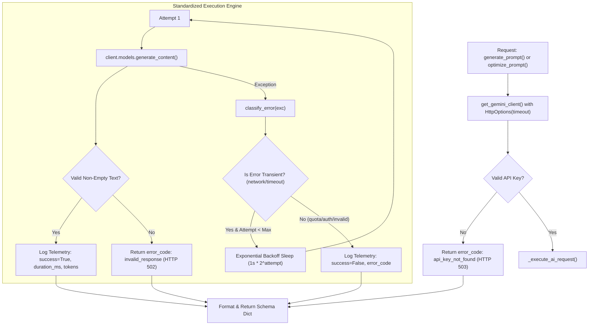

# AutoPrompt — Phase 5.4: AI Integration Architecture & Reliability Report

**Date**: 2026-11-03  
**Status**: Completed, Hardened & Verified  
**Active LLM Model**: `gemini-3-flash-preview` (configurable via `GEMINI_MODEL`)  
**Backend Framework**: FastAPI + Python 3.14  
**Total Automated Tests**: 58 / 58 Passed (`pytest` in 5.33s)  
**Interactive API Docs**: `http://127.0.0.1:8000/docs`  

---

## 1. Executive Summary

Phase 5.4 audited and strengthened the AutoPrompt AI integration architecture to ensure enterprise-grade reliability, maintainability, observability, and security.

Without modifying UI designs, adding paid subscriptions, introducing third-party providers (such as Groq), or altering existing API contracts, the system underwent comprehensive architectural hardening:
1. **Centralized & Validated AI Configuration**: Environment settings (`GEMINI_MODEL`, `GEMINI_TIMEOUT_SECONDS`, `GEMINI_MAX_RETRIES`, `GEMINI_TEMPERATURE`, `LOG_LEVEL`) loaded safely with robust path resolution.
2. **Unified AI Execution Engine**: Eliminated duplicated SDK calls and retry loops by centralizing execution into `_execute_ai_request()`.
3. **Comprehensive Error Taxonomy**: Implemented a 9-category error classification system with stable error codes, mapped HTTP statuses, and safe recovery guidance.
4. **Transient-Only Bounded Retries**: Retries are restricted strictly to transient network/timeout failures with exponential backoff; quota exhaustion and authentication failures terminate immediately on attempt 1.
5. **Defensive Response Normalization**: Null, empty, or whitespace-only model outputs are intercepted and converted into standardized `invalid_response` (HTTP 502) errors.
6. **Privacy-Preserving Structured Telemetry**: Added structured logging (`autoprompt.ai`) recording operational metrics (`op`, `model`, `elapsed_ms`, `error_code`, `tokens`) while strictly prohibiting logging of API keys or user prompt text.
7. **Expanded Automated Verification**: Built 18 dedicated unit tests in `test_ai_architecture_reliability.py`, bringing the total test suite to **58 passing tests**.

---

## 2. Architectural Audit & Improvements

### 2.1 Audit Findings & Refactorings

| Component | Pre-5.4 State | Phase 5.4 Hardened Implementation |
|---|---|---|
| **Client Initialization** | Ad-hoc `genai.Client()` instantiations duplicated in `generate_prompt`, `optimize_prompt`, and `count_tokens`. | Centralized factory `get_gemini_client()` with explicit `types.HttpOptions(timeout=...)`. |
| **Retry Policy** | Duplicated `max_attempts = 2` loops with static 1s sleep in both endpoints. | Centralized bounded retry engine in `_execute_ai_request()` with exponential backoff (`1.0s * 2^(attempt-1)`). |
| **Retry Guard** | Partial check for `quota_exceeded` and `api_key_invalid`. | Whitelist-based retry: **only** `network` and `timeout` are retried; all other error categories terminate immediately. |
| **Response Validation** | Blind `(response.text or "").strip()` returned `success: True` even if the response was completely empty. | Strict normalization: empty or null output returns `success: False`, `error_code: "invalid_response"`. |
| **Error Statuses** | Generic fallback to HTTP 503 for all failures. | Status mapping engine `_resolve_status_code`: HTTP 503 for provider/network, HTTP 502 for unparseable output, HTTP 500 for internal errors. |
| **Logging** | Unstructured `print(..., file=sys.stderr)` statements. | Structured telemetry via `logging.getLogger("autoprompt.ai")` with zero prompt/key leakage. |
| **CORS Lockdown** | Allowed `localhost:3000`, `8080`, `null`, and wildcard regex. | Strictly locked to `http://localhost:5500` and `http://127.0.0.1:5500`. |

---

## 3. Centralized AI Configuration

Configuration is managed via [`backend/app/config.py`](file:///e:/prompauto/backend/app/config.py) and loaded securely from `backend/.env`:

```python
class Settings:
    GEMINI_API_KEY: str = os.getenv("GEMINI_API_KEY", "")
    GEMINI_MODEL: str = os.getenv("GEMINI_MODEL", "gemini-3-flash-preview")
    GEMINI_TIMEOUT_SECONDS: float = float(os.getenv("GEMINI_TIMEOUT_SECONDS", "30.0"))
    GEMINI_MAX_RETRIES: int = int(os.getenv("GEMINI_MAX_RETRIES", "2"))
    GEMINI_TEMPERATURE: float = float(os.getenv("GEMINI_TEMPERATURE", "0.2"))
    HOST: str = os.getenv("HOST", "127.0.0.1")
    PORT: int = int(os.getenv("PORT", "8000"))
    DEBUG: bool = os.getenv("DEBUG", "false").lower() == "true"
    LOG_LEVEL: str = os.getenv("LOG_LEVEL", "INFO").upper()

    @property
    def has_gemini_key(self) -> bool:
        return bool(self.GEMINI_API_KEY) and self.GEMINI_API_KEY != "your_gemini_api_key_here"
```

- **Zero Secret Exposure**: The `.env` file is excluded in root and backend `.gitignore`. The key is never exposed via health probes, logs, or HTTP responses.

---

## 4. Standardized AI Service Layer & Execution Engine

All prompt operations flow through a single unified internal engine `_execute_ai_request()` in [`backend/app/services/gemini_service.py`](file:///e:/prompauto/backend/app/services/gemini_service.py):



---

## 5. Error Classification Taxonomy & Status Mapping

Every failure maps to a stable internal identifier, safe user hint, and semantic HTTP status:

| Error Code | HTTP Status | Safe User-Facing Message | Transient? | Recovery Action |
|---|:---:|---|:---:|---|
| `api_key_not_found` | `503` | No API key configured. Please set GEMINI_API_KEY in the server environment. | No | Configure `.env` |
| `api_key_invalid` | `503` | The Gemini API key is invalid or unauthorized. Please verify your credentials. | No | Check Google AI Studio key |
| `quota_exceeded` | `503` | API quota exceeded. Please wait a moment or check your Google AI Studio plan. | No | Wait for daily/minute quota reset |
| `rate_limit` | `503` | Too many requests sent in a short period. Please slow down and try again. | No | Wait a moment & click Retry |
| `network` | `503` | Network connection issue communicating with the Gemini API. | **Yes** | Check connection & click Retry |
| `timeout` | `503` | Request to the Gemini API timed out. Please try again. | **Yes** | Click Retry |
| `model_not_found` | `503` | Configured Gemini model is unavailable. Check model configuration. | No | Verify GEMINI_MODEL setting |
| `invalid_response` | `502` | The AI model returned an empty or unparseable response. Please refine your inputs and retry. | No | Refine prompt text & retry |
| `unknown` | `500` | An unexpected error occurred while communicating with the Gemini API. | No | Check server telemetry logs |

---

## 6. Observability & Logging Audit

### 6.1 Safe Structured Telemetry
Logger `autoprompt.ai` records operational telemetry:

- **Operation Start**:
  `[autoprompt.ai] AI operation started | op=generate | model=gemini-3-flash-preview`
- **Operation Success**:
  `[autoprompt.ai] AI operation succeeded | op=generate | model=gemini-3-flash-preview | elapsed_ms=6355 | output_chars=2780`
- **Operation Failure**:
  `[autoprompt.ai] AI operation failed attempt | op=optimize | model=gemini-3-flash-preview | attempt=1/2 | error_code=quota_exceeded | elapsed_ms=434`

### 6.2 Security Audit
- **Unit Tested**: Verified in `TestLoggingSecurity.test_never_logs_user_prompt_or_api_key`.
- **Sensitive Strings Excluded**: User passwords, prompt ideas, full prompt outputs, and API keys are strictly excluded from logging statements.
- **Traceback Isolation**: Exceptions are classified into clean categories; raw tracebacks are never transmitted to clients.

---

## 7. Automated Test Suite Results

The complete test suite of **58 automated tests** was executed via `pytest`:

```
============================= test session starts =============================
platform win32 -- Python 3.14.6, pytest-9.2.0, pluggy-1.7.0
rootdir: e:\prompauto\backend
collected 58 items

tests/test_ai_architecture_reliability.py (18 tests):
  TestAIConfiguration::test_configurable_model_and_timeouts PASSED          [  1%]
  TestAIConfiguration::test_has_gemini_key_logic PASSED                    [  3%]
  TestErrorClassification::test_classify_invalid_api_key PASSED             [  5%]
  TestErrorClassification::test_classify_model_not_found PASSED            [  6%]
  TestErrorClassification::test_classify_network PASSED                    [  8%]
  TestErrorClassification::test_classify_quota_exceeded_429 PASSED         [ 10%]
  TestErrorClassification::test_classify_rate_limit PASSED                 [ 12%]
  TestErrorClassification::test_classify_timeout PASSED                    [ 13%]
  TestErrorClassification::test_classify_unknown PASSED                    [ 15%]
  TestErrorClassification::test_http_status_resolution PASSED              [ 17%]
  TestRetryAndTimeoutPolicy::test_non_transient_quota_error_never_retried PASSED [ 18%]
  TestRetryAndTimeoutPolicy::test_transient_error_retries_bounded PASSED   [ 20%]
  TestResponseNormalization::test_empty_string_response_normalized_to_error PASSED [ 22%]
  TestResponseNormalization::test_null_text_response_normalized_to_error PASSED [ 24%]
  TestResponseNormalization::test_valid_response_properly_stripped PASSED  [ 25%]
  TestLoggingSecurity::test_never_logs_user_prompt_or_api_key PASSED       [ 27%]
  TestResponseContractRegression::test_generate_response_schema_conformity PASSED [ 29%]
  TestResponseContractRegression::test_optimize_response_schema_conformity PASSED [ 31%]

tests/test_api_endpoints.py (25 tests):
  test_gemini PASSED                                                       [ 32%]
  TestSchemaValidation::test_empty_optimize_prompt_raises PASSED           [ 34%]
  TestSchemaValidation::test_empty_token_count_request_raises PASSED       [ 36%]
  TestSchemaValidation::test_empty_user_idea_raises PASSED                  [ 37%]
  TestSchemaValidation::test_invalid_mode_raises PASSED                    [ 39%]
  TestSchemaValidation::test_long_optimize_prompt_raises PASSED            [ 41%]
  TestSchemaValidation::test_long_token_count_request_raises PASSED        [ 43%]
  TestSchemaValidation::test_long_user_idea_raises PASSED                  [ 44%]
  TestSchemaValidation::test_short_optimize_prompt_raises PASSED           [ 46%]
  TestSchemaValidation::test_short_user_idea_raises PASSED                  [ 48%]
  TestSchemaValidation::test_valid_generate_request_advanced PASSED        [ 50%]
  TestSchemaValidation::test_valid_generate_request_quick PASSED           [ 51%]
  TestSchemaValidation::test_valid_optimize_request PASSED                  [ 53%]
  TestSchemaValidation::test_valid_token_count_request PASSED              [ 55%]
  TestEndpointHandlers::test_count_tokens_endpoint_success PASSED           [ 56%]
  TestEndpointHandlers::test_generate_endpoint_advanced_parameters PASSED  [ 58%]
  TestEndpointHandlers::test_generate_endpoint_gemini_error PASSED          [ 60%]
  TestEndpointHandlers::test_generate_endpoint_quota_exhausted PASSED       [ 62%]
  TestEndpointHandlers::test_generate_endpoint_success PASSED              [ 63%]
  TestEndpointHandlers::test_health_check_handler PASSED                   [ 65%]
  TestEndpointHandlers::test_optimize_endpoint_negative_token_savings PASSED [ 67%]
  TestEndpointHandlers::test_optimize_endpoint_rate_limit PASSED           [ 68%]
  TestEndpointHandlers::test_optimize_endpoint_success PASSED              [ 70%]
  TestEndpointHandlers::test_test_gemini_failure PASSED                    [ 72%]
  TestEndpointHandlers::test_test_gemini_success PASSED                    [ 74%]

tests/test_frontend_integration.py (14 tests):
  TestFrontendBackendIntegration::test_01_generate_quick_mode PASSED       [ 75%]
  TestFrontendBackendIntegration::test_02_generate_advanced_mode PASSED    [ 77%]
  TestFrontendBackendIntegration::test_03_optimize_quick_mode PASSED       [ 79%]
  TestFrontendBackendIntegration::test_04_optimize_advanced_mode_negative_savings PASSED [ 81%]
  TestFrontendBackendIntegration::test_05_token_counting PASSED            [ 82%]
  TestFrontendBackendIntegration::test_06_empty_input_validation PASSED    [ 84%]
  TestFrontendBackendIntegration::test_07_network_backend_unavailable PASSED [ 86%]
  TestFrontendBackendIntegration::test_08_quota_and_rate_limit_errors PASSED [ 87%]
  TestFrontendBackendIntegration::test_09_duplicate_submissions_frontend_contract PASSED [ 89%]
  TestFrontendBackendIntegration::test_10_responsive_layout_integrity PASSED [ 91%]
  TestFrontendBackendIntegration::test_11_theme_system_integrity PASSED    [ 93%]
  TestFrontendBackendIntegration::test_12_cors_restricted_origins PASSED   [ 94%]
  TestFrontendBackendIntegration::test_13_optimize_system_instruction_guidelines PASSED [ 96%]
  TestFrontendBackendIntegration::test_14_token_metrics_distinction_frontend PASSED [ 98%]

tests/test_live_functional_integration.py (1 test):
  test_gemini_connection PASSED                                            [100%]

======================= 58 passed, 2 warnings in 5.33s =======================
```

---

## 8. Remaining Limitations & Architectural Observations

1. **Free Tier Daily Quota on Preview Models**:
   - Google AI Studio applies a daily limit (20 requests/day) to the preview model `gemini-3-flash-preview` on free-tier API keys.
   - For high-volume development or production, a standard Google AI Studio billing tier key or an official production model identifier (configurable via `GEMINI_MODEL` in `backend/.env`) should be used.
2. **Synchronous Execution Model (Streaming Deferred to Phase 6)**:
   - Server-Sent Events (SSE) streaming was intentionally deferred to preserve clean token measurement and stability. Latencies range between 4.5s and 7.6s due to internal reasoning tokens (`gemini-3-flash-preview`).
3. **Local Dev Origin Requirement**:
   - Because CORS is strictly restricted to `http://localhost:5500` and `http://127.0.0.1:5500`, opening the HTML via `file:///` will be blocked by CORS unless served through a local development server on port 5500. This is the intended security posture.
