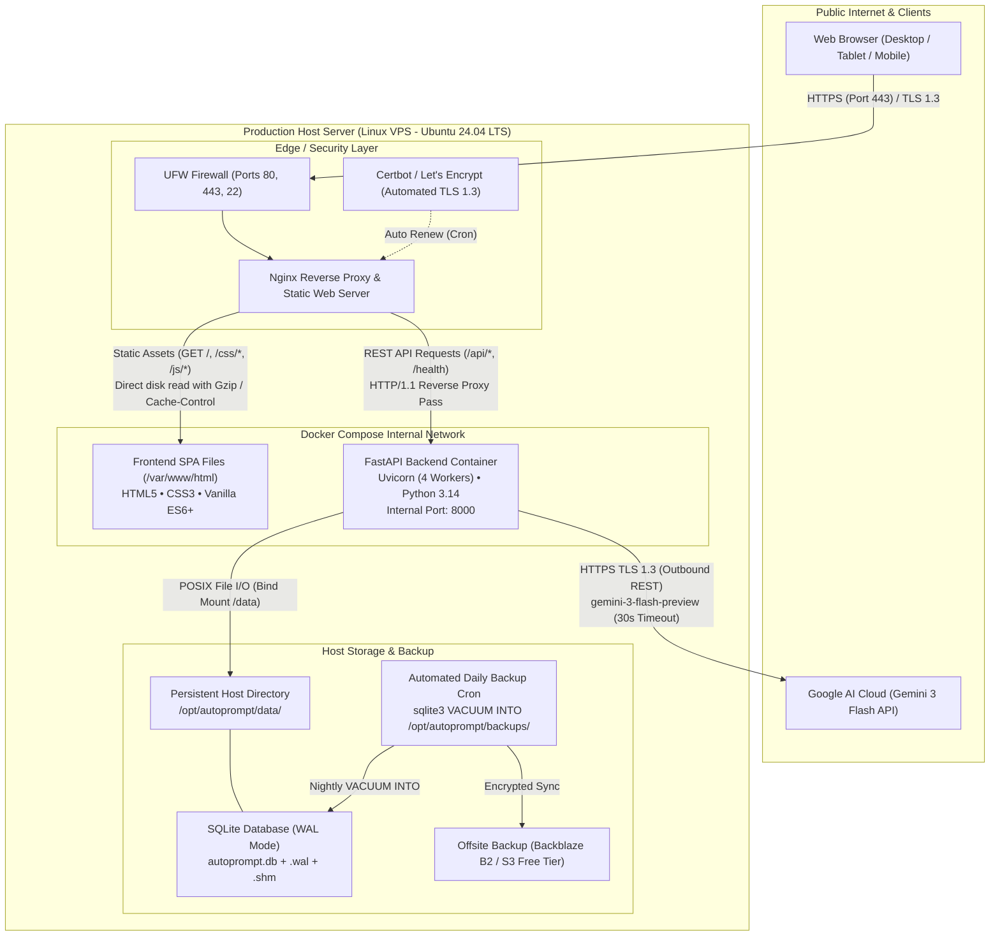

# AutoPrompt — Production Architecture Specification (Phase 8.1)

**Document Version**: 1.0.0  
**Date**: November 5, 2026  
**Author**: Senior DevOps Engineer & Cloud Infrastructure Architect  
**Status**: Analysis & Planning Only (Pre-Deployment)

---

## 1. Executive Summary

This document specifies the target production deployment architecture for AutoPrompt v1.0.0. The architecture is engineered to deliver high performance (> 6,700 RPS capacity), strict SQLite WAL persistence integrity, zero-downtime container updates, zero cold starts, enterprise-grade TLS encryption, and zero unexpected infrastructure costs.

Based on our comprehensive infrastructure evaluation in [`DEPLOYMENT_COST_COMPARISON.md`](DEPLOYMENT_COST_COMPARISON.md), AutoPrompt adopts a **Unified Single-Host Containerized Architecture** orchestrated by Docker Compose behind an Nginx reverse proxy on a dedicated Linux VPS (e.g., Hetzner Cloud CX22 or Oracle Cloud Always-Free).

---

## 2. System Architecture Diagram



---

## 3. Core Component Evaluation & Design

### A. Frontend Delivery & Hosting
- **Architecture**: Nginx serves the static SPA (`autoprompt-prototype/`) directly from container/host disk.
- **Optimization Strategy**:
  - Gzip and Brotli compression enabled for `text/html`, `text/css`, and `application/javascript`.
  - Cache-Control headers: Immutable caching for static assets (`max-age=31536000, immutable`), `no-cache` for `index.html`.
  - Security headers injected by Nginx: `X-Frame-Options: DENY`, `X-Content-Type-Options: nosniff`, `Referrer-Policy: strict-origin-when-cross-origin`.
- **API Base URL Binding**:
  - Because frontend and backend are unified under the same domain, frontend scripts utilize relative URLs (`/api/...`) or `window.AUTOPROMPT_API_URL = ''`.
  - **Zero CORS Preflight**: Eliminates browser `OPTIONS` preflight roundtrips completely, saving 80–150 ms of network latency on every user action.

### B. FastAPI Application Server
- **Runtime**: Python 3.10+ (Docker image based on `python:3.12-slim` or `python:3.14-slim`).
- **Process Manager**: Uvicorn running with 2 to 4 worker processes (`uvicorn app.main:app --workers 4 --host 0.0.0.0 --port 8000`).
- **Lifecycle Management**: Docker container configured with `restart: unless-stopped` and Docker health checks hitting `GET /health` every 30 seconds.

### C. Reverse Proxy & Ingress
- **Nginx Responsibilities**:
  - Terminates TLS/SSL using modern cipher suites (TLS 1.2 and TLS 1.3).
  - Enforces HTTP to HTTPS redirection (HTTP 301).
  - Buffers client requests to prevent slowloris attacks.
  - Enforces request body size limits (`client_max_body_size 1m;`).
  - Rate limits abusive clients (`limit_req_zone $binary_remote_addr zone=api_limit:10m rate=30r/m;`).

### D. Unified vs. Decoupled Architecture Trade-Off

| Evaluation Aspect | Unified Architecture (Selected) | Decoupled Architecture (Static CDN + API Container) |
| :--- | :--- | :--- |
| **Domain Management** | Single domain (e.g., `autoprompt.example.com`) | Two domains (`app.example.com` + `api.example.com`) |
| **CORS Policy** | **Zero CORS needed** (Same-origin policy) | Complex CORS headers required; preflight latency on writes |
| **Deployment Sync** | Atomic: UI and API updated together via Compose | Dual deployments; potential contract mismatches |
| **Operational Overhead** | Single host to monitor | Two independent platforms with separate failure domains |
| **Cost** | Fixed $0.00 – $3.60/month | Free static + $7.00/month container with persistence |

**Conclusion**: The **Unified Architecture** is vastly superior for AutoPrompt v1.0, eliminating CORS preflight latency, simplifying domain/SSL management, and ensuring atomic updates.

---

## 4. SQLite Production Assessment & Persistence Strategy

### A. Suitability for Expected v1.0 Workload
- **Read Scalability**: AutoPrompt's read operations (fetching saved prompts, listing history) run in **0.94 ms to 2.05 ms** at 1,000 records. Under WAL mode, readers never block writers, and writers never block readers.
- **Write Volume**: User writes occur only when generating a prompt, saving a prompt, or updating history. At expected v1.0 scale (tens to hundreds of daily active users), write throughput is < 1 write/sec. SQLite easily handles **50–100 transactions/sec** in WAL mode.
- **Verdict**: Migrating to PostgreSQL is **unnecessary and discouraged** for v1.0. PostgreSQL would introduce network roundtrips, database connection pool tuning, separate database container memory overhead (~150MB+), and ongoing maintenance costs.

### B. Persistent Disk Requirements & WAL Mode Safety
- **Host Bind-Mount**: The database directory must be bind-mounted from the host OS filesystem (`/opt/autoprompt/data:/app/data`) to the FastAPI container.
- **Filesystem Type**: Must reside on a local block storage device (ext4 or xfs).
- **Prohibited Configurations**:
  - Never place SQLite database files on network filesystems (NFS, SMB, AWS EFS, GCS Fuse). Network filesystems lack compliant POSIX advisory lock implementations and will result in `SQLITE_IOERR` or `SQLITE_BUSY` corruption.
- **WAL Journaling**:
  - Existing database initialization explicitly sets:
    ```sql
    PRAGMA journal_mode=WAL;
    PRAGMA foreign_keys=ON;
    PRAGMA synchronous=NORMAL;
    ```
  - This configuration survives container restarts and maintains ACID transactional integrity.

### C. Backup and Disaster Recovery Strategy
1. **Online Non-Blocking Backups**:
   - Utilize SQLite's official online backup command via a daily cron job:
     ```bash
     sqlite3 /opt/autoprompt/data/autoprompt.db "VACUUM INTO '/opt/autoprompt/backups/autoprompt-$(date +\%Y\%m\%d_\%H\%M\%S).db'"
     ```
   - `VACUUM INTO` creates a clean, fully compacted, defragmented backup file atomically without interrupting active readers or writers.
2. **Offsite Backup Retention**:
   - Backups are compressed with gzip (`gzip -9`) and encrypted.
   - Synced to free cloud object storage (e.g. Backblaze B2 offers 10GB permanently free; Cloudflare R2 offers 10GB free with zero egress fees).
   - Retain 7 daily backups, 4 weekly backups, and 3 monthly backups.
3. **Disaster Recovery**:
   - Recovery time objective (RTO): < 5 minutes (restore single file and restart container).
   - Recovery point objective (RPO): < 24 hours.

---

## 5. Security & Secrets Management

### A. Production Environment Controls
1. **GEMINI_API_KEY Protection**:
   - Stored strictly in `/opt/autoprompt/.env` on the host server with filesystem permissions `chmod 600`.
   - Injected into the FastAPI container via Docker Compose `env_file`.
   - Never embedded in client-side code, Git repositories, Docker images, or build logs.
2. **Documentation & Debug Suppression**:
   - Set `DEBUG=false` in production `.env`.
   - This automatically disables Swagger UI (`/docs`), ReDoc (`/redoc`), and interactive schema enumeration.
3. **Diagnostics Endpoint Gating (`/api/test-gemini`)**:
   - Must be disabled in public production to prevent unauthenticated quota burning.
   - Nginx configuration will block external access to `/api/test-gemini` (`return 404;`) while allowing internal monitoring.
4. **Information Disclosure Prevention**:
   - In Phase 7.3, `sys.version` and `platform.system()` were removed from `/health`.
   - Nginx `server_tokens off;` will suppress web server version numbers in HTTP response headers.

### B. Rate Limiting & Abuse Protection
- **Nginx Leaky Bucket Rate Limiting**:
  - Static assets: Unlimited.
  - `/api/generate` & `/api/optimize`: Capped at **15 requests/minute per client IP** to match Google Gemini's free tier limits.
  - `/api/count-tokens`: Capped at **60 requests/minute per client IP**.
- **Request Size Enforcement**:
  - `client_max_body_size 1m;` in Nginx stops memory exhaustion attacks before payloads reach FastAPI.

---

## 6. Gemini API Cost & Quota Management

### A. Free Tier Quota Limits & Lifecycle
- **Model**: `gemini-3-flash-preview` (fallback configured to `gemini-2.0-flash` if model deprecation occurs).
- **Google AI Studio Free Tier Limits**:
  - **15 RPM** (Requests Per Minute).
  - **1,000,000 TPM** (Tokens Per Minute).
  - **1,500 RPD** (Requests Per Day).
- **Zero Surprise Billing Guarantee**:
  - Billing is disabled in the Google Cloud / AI Studio project.
  - When the 1,500 daily requests or 15 RPM limit is exceeded, Google returns HTTP 429 (`ResourceExhausted`).
  - Google will **never charge a credit card** when billing is inactive.

### B. User Experience During Quota Exhaustion
- AutoPrompt's standardized error handling maps HTTP 429 to error code `quota_exceeded`.
- The user interface displays a polite notification banner:
  > *"API service quota temporarily reached. The system is operating on a free AI provider tier. Please try again in a few moments."*
- Saved prompts and local workspace tools remain 100% operational even when the external AI provider is temporarily unavailable.

---

## 7. Operational Monitoring & Health Checks

1. **Uptime Monitoring**:
   - Configure a free external monitor (e.g. UptimeRobot or Better Uptime) hitting `GET /health` every 5 minutes.
   - `/health` returns `{ "status": "ok", "gemini_key_configured": true }` in **0.018 ms** without consuming external Gemini quota.
2. **Container Healthcheck**:
   - Docker daemon monitors container health via `curl -f http://127.0.0.1:8000/health || exit 1`.
3. **Structured Logging**:
   - Docker logs rotated automatically via `json-file` driver (`max-size: 10m`, `max-file: 3`).

---

## 8. Summary of Architectural Decisions

| Area | Decision | Primary Rationale |
| :--- | :--- | :--- |
| **Hosting Model** | Unified Single-Host VPS (Hetzner CX22 or OCI) | Lowest cost ($0–$3.60/mo), zero cold starts, native POSIX locks |
| **Ingress / Proxy** | Nginx with Certbot (Let's Encrypt TLS 1.3) | High-speed static caching, automated SSL, rate limiting |
| **App Runtime** | Docker Compose + Uvicorn (FastAPI) | Reproducible environment, isolated dependencies, easy rollback |
| **Database** | SQLite 3 in WAL Mode (Host Bind-Mount) | Sub-millisecond performance, zero network latency, zero license cost |
| **Backups** | Daily `sqlite3 VACUUM INTO` + Offsite sync | Atomic, non-blocking snapshots, zero database lock time |
| **CORS Policy** | Same-Origin Unified Reverse Proxy | Eliminates CORS configuration and removes preflight HTTP roundtrips |
| **Cost Protection** | Unbilled Google AI Studio tier + Fixed VPS | Impossible to incur unexpected charges |
