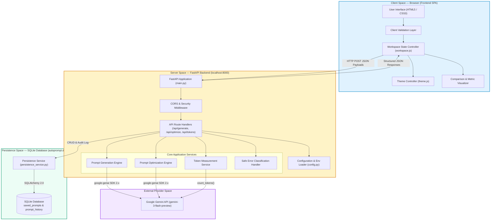
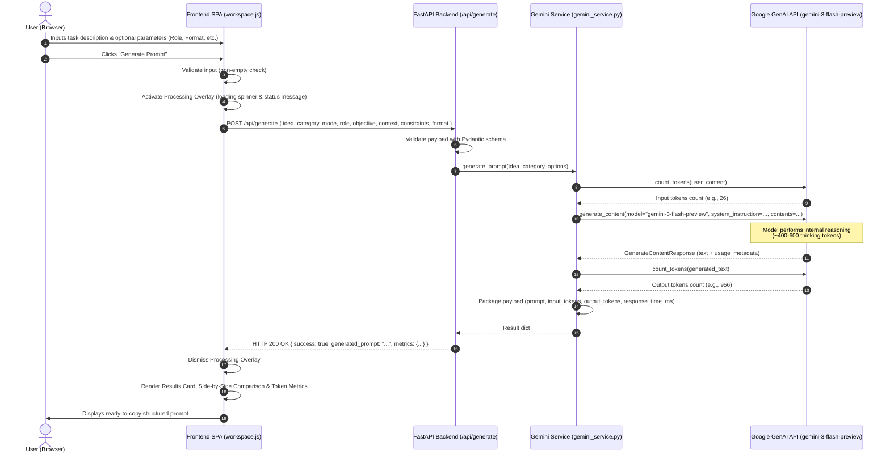
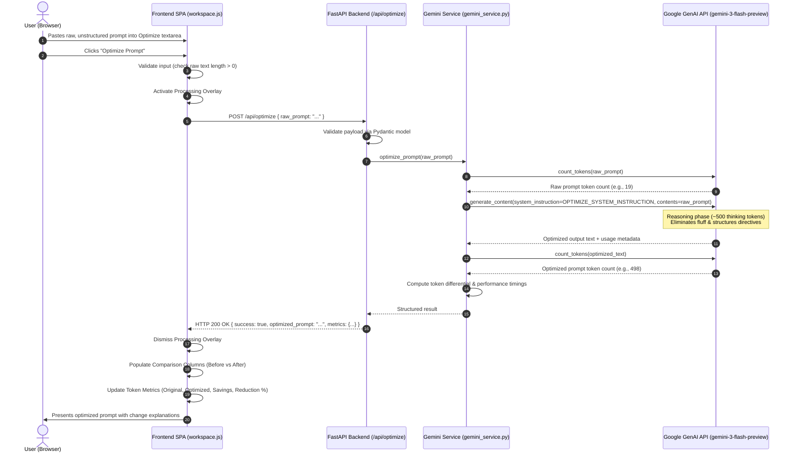
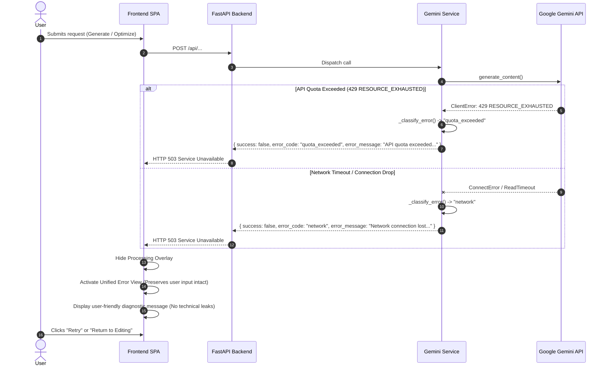

# AutoPrompt — Technical Architecture Document

**Version**: 1.2.0  
**Phase**: Phase 6.0 — Local Persistence, Saved Prompts & History  
**Status**: Production Architecture Specification  
**Target LLM Model**: `gemini-3-flash-preview` (configurable via `GEMINI_MODEL`)  
**Backend Framework**: Python 3.14 + FastAPI + SQLAlchemy 2.0  
**Database**: SQLite (`autoprompt.db`)  
**Frontend Stack**: Semantic HTML5, CSS3, Vanilla ES6+ JavaScript  

---

## 1. Executive Summary & Architecture Vision

**AutoPrompt** is a developer and creator SaaS application designed to solve a core problem in modern generative AI: **vague, inefficient, and under-specified prompts that waste tokens and produce poor model outputs.**

AutoPrompt bridges this gap by delivering two primary services:
1. **Generate**: Takes a high-level task or concept and produces a complete, structured, production-ready system prompt with defined roles, context, objectives, step-by-step directives, deliverables, and guardrails.
2. **Optimize**: Ingests an existing prompt and refines it into a high-density, structured prompt that preserves 100% of the original intent while eliminating ambiguity, preventing hallucinated schemas, and structuring deliverables.

The architecture follows a clean **Decoupled Client-Server Pattern**:
- A lightweight, responsive, accessible **Single Page Application (SPA)** in the frontend.
- A high-performance **FastAPI backend** acting as the secure gateway, prompt orchestrator, token metric calculator, and AI proxy.
- Direct server-to-server integration with **Google Gemini API** (`gemini-3-flash-preview`) via the official `google-genai` SDK.

---

## 2. Core Architecture Principles & Constraints

To ensure zero technical debt and rock-solid production readiness, AutoPrompt adheres strictly to the following architectural constraints:

| Principle / Constraint | Implementation Guarantee |
|---|---|
| **Zero Secret Exposure** | API keys (`GEMINI_API_KEY`) reside exclusively in server-side environment variables loaded via `.env`. No client-side code, headers, URL parameters, or browser storage ever access or store secrets. |
| **Provider Isolation** | The current phase exclusively utilizes Google Gemini (`gemini-3-flash-preview`). LLM interactions are isolated behind an abstract service interface in `app/services/` to facilitate future provider extensibility without frontend refactoring. |
| **No Paid Third-Party Services** | The system operates entirely on free-tier, self-hosted, or local capabilities (local Python FastAPI server, Google AI Studio free-tier API, local browser storage). No automatic billing or paid services are required. |
| **Preservation of Frontend Integrity** | The existing frontend UI structure, themes, animations, and accessibility features are preserved. Integration transitions mock client functions into real asynchronous API fetch calls. |
| **Real Token Accounting** | No simulated character multipliers in production. Input and output token counts are calculated using the official SDK tokenizer (`client.models.count_tokens()`). |

---

## 3. High-Level System Architecture

The following diagram illustrates the complete AutoPrompt system architecture, showing boundaries between client space, server space, and external providers:



---

## 4. Subsystem Decomposition & Component Responsibilities

### 4.1 Frontend Presentation Layer (Client)
The frontend is built with pure, framework-free Web standards (HTML5, CSS3 with Custom Properties, Vanilla ES6+):
- **DOM & View Controller (`workspace.js`)**: Manages the multi-tab interface (Generate vs. Optimize), form state, quick vs. advanced mode toggle, processing overlays, and results view transitions.
- **Client-Side Validator**: Enforces non-empty input validation, trims whitespace, and provides immediate inline error messages before network transmission.
- **Theme Manager (`theme.js`)**: Provides instantaneous dark/light theme switching with local persistence (`localStorage`).
- **Results & Metric Renderer**: Formats markdown prompt outputs into sanitized pre/code blocks, side-by-side comparison panels, and dynamic token metric cards.

### 4.2 Backend Application Layer (FastAPI)
The backend acts as the secure, high-performance orchestration layer:
- **API Gateway (`main.py`)**: Defines route contracts, manages request lifecycle, enforces CORS whitelisting (preventing unauthorized cross-site requests), and handles dependency injection.
- **Configuration & Security (`config.py`)**: Loads environment variables strictly at application boot from `backend/.env`. Exposes immutable settings (`GEMINI_API_KEY`, `GEMINI_MODEL`, `PORT`).
- **Prompt Generation Engine (`app/services/gemini_service.py`)**: Applies standardized, version-controlled system instructions (`GENERATE_SYSTEM_INSTRUCTION`) to turn raw user inputs into structured, enterprise-grade prompts.
- **Prompt Optimization Engine (`app/services/gemini_service.py`)**: Implements strict refinement directives (`OPTIMIZE_SYSTEM_INSTRUCTION`) that improve specificity, enforce analytical logic, eliminate fluff, and prohibit hallucinated data schemas.
- **Token Accounting Service (`app/services/gemini_service.py`)**: Calls `client.models.count_tokens()` to measure true token lengths for original inputs and generated outputs, computing accurate token delta metrics.
- **Error Classifier (`app/services/gemini_service.py`)**: Intercepts SDK exceptions and maps them into categorized, safe error payloads (`api_key_invalid`, `quota_exceeded`, `rate_limit`, `network`, `timeout`), completely preventing API key or traceback leaks.

### 4.3 Persistence Layer (Implemented Phase 6.0)
- **Database Engine (`app/db/session.py`)**: Local SQLite database (`autoprompt.db`) managed via SQLAlchemy 2.0 with connection pooling and WAL mode. Fast in-memory SQLite (`sqlite:///:memory:`) is used for hermetic automated testing.
- **Data Models (`app/db/models.py`)**:
  - `SavedPrompt`: Stores user-saved prompts with title, content, category, operation type, timestamps, and composite indexing.
  - `PromptHistory`: Append-only audit log recording every generation and optimization execution with original input, generated/optimized output, token accounting metrics (`tokens_before`, `tokens_after`, `tokens_saved`), model identifier, and timestamp.
- **Persistence Service (`app/services/persistence_service.py`)**: Encapsulates CRUD, multi-criteria filtering (category, operation, search keywords), pagination, and atomic transaction handling.
- **Frontend Controller (`autoprompt-prototype/js/persistence.js`)**: Manages modal views, debounced search, badge updates, and bidirectional state synchronization with `workspace.js`.

---

## 5. Detailed Request Flows & Interaction Diagrams

### 5.1 Generate Prompt Flow

The Generate workflow accepts either a simple idea ("Quick Mode") or rich contextual parameters ("Advanced Mode"):



### 5.2 Optimize Prompt Flow

The Optimize workflow ingests an existing, unrefined prompt and compresses it into high-density directives:



### 5.3 Error Handling & Quota Recovery Flow



---

## 6. Technical Division of Responsibilities

A clear boundary between client-side and server-side execution prevents security vulnerabilities, maintains high performance, and simplifies debugging:

| Functional Responsibility | Frontend (Client) | Backend (FastAPI) | External (Gemini) |
|---|:---:|:---:|:---:|
| **UI Presentation & Styling** | ✅ Primary Owner | ❌ No involvement | ❌ No involvement |
| **Input Presence & Whitespace Validation** | ✅ Immediate feedback | ✅ Defensive validation | ❌ |
| **State & Preference Persistence (Theme/Workspace)** | ✅ `localStorage` | ❌ (Future DB Phase) | ❌ |
| **API Secret (`GEMINI_API_KEY`) Management** | ❌ **PROHIBITED** | ✅ Exclusive Owner (`.env`) | ❌ |
| **System Instruction Injection** | ❌ Never in client | ✅ Server-controlled | ❌ |
| **Prompt Synthesis & Reasoning** | ❌ | ❌ | ✅ Execution engine |
| **Real Token Count Measurement** | ❌ (Client cannot count) | ✅ Proxies to official SDK | ✅ Authoritative tokenizer |
| **Error Sanitization & Traceback Masking** | ❌ Displays safe msg | ✅ Sanitizes raw exceptions | ❌ Raw error originator |
| **Rate Limiting & Backoff Orchestration** | ❌ (Provides Retry btn) | ✅ Server-side backoff/retry | ✅ Enforces limits |

---

## 7. Reliability & Resilience Engineering

AutoPrompt maintains high availability and delivers clear, reassuring user feedback even during third-party degradation:

### 7.1 Handling Provider Quotas & Rate Limits (429 RESOURCE_EXHAUSTED)
- **Root Cause**: Third-party providers enforce dynamic request-per-minute (RPM) and daily project limits (e.g., Google AI Studio Free Tier has daily quota limits on preview models).
- **Backend Mitigation**:
  - Centralized error classifier checks exception `status_code == 429` and message payloads.
  - Rate limit and quota exhaustion errors are treated as **non-transient**; they are immediately aborted on attempt 1 without repeated requests that would burn rate limits.
  - Mapped to a safe `HTTP 503` with `error_code: "quota_exceeded"` or `"rate_limit"`.
- **Frontend Reaction**: The UI transitions to the `unified-error-view`, displays a user-friendly message, and preserves the user's textarea content without page reload, allowing retry when the quota resets.

### 7.2 Bounded Retries for Transient Errors
- **Transient Errors**: Network connection interruptions (`getaddrinfo failed`, socket resets) and request timeouts.
- **Policy**: Maximum 2 attempts (`settings.GEMINI_MAX_RETRIES`) with exponential backoff (`1.0s * 2^(attempt-1)`).
- **Non-Transient Errors**: Quota exhaustion, invalid API key, missing configuration, unparseable response, and model deprecation are **never retried**.

### 7.3 Explicit Timeout Management
- **Configuration**: Explicitly configured via `settings.GEMINI_TIMEOUT_SECONDS` (default: 30.0s).
- **Enforcement**: Converted to milliseconds and injected directly into `types.HttpOptions(timeout=...)` on the official SDK client.
- **Client Fallback**: Frontend `AbortController` enforces a 45-second circuit breaker to prevent hanging browser UI states.

### 7.4 Response Normalization & Guardrails
- **Problem**: Provider responses may return empty strings, null content blocks, or blocked safety ratings.
- **Mitigation**: The execution engine inspects `response.text`. If null or whitespace-only, it rejects the response, logs candidate finish reasons safely, and returns `error_code: "invalid_response"` (HTTP 502).

### 7.5 Centralized Error Taxonomy

| Error Code | HTTP Status | User Message | Recovery Action |
|---|:---:|---|---|
| `api_key_not_found` | 503 | No API key configured. Please set GEMINI_API_KEY in the server environment. | Configure `.env` file |
| `api_key_invalid` | 503 | The Gemini API key is invalid or unauthorized. Please verify your credentials. | Check AI Studio credentials |
| `quota_exceeded` | 503 | API quota exceeded. Please wait a moment or check your Google AI Studio plan. | Wait for quota window reset |
| `rate_limit` | 503 | Too many requests sent in a short period. Please slow down and try again. | Wait a few seconds & retry |
| `network` | 503 | Network connection issue communicating with the Gemini API. | Check network & retry |
| `timeout` | 503 | Request to the Gemini API timed out. Please try again. | Retry request |
| `model_not_found` | 503 | Configured Gemini model is unavailable. Check model configuration. | Verify GEMINI_MODEL setting |
| `invalid_response` | 502 | The AI model returned an empty or unparseable response. Please refine your inputs and retry. | Refine prompt & retry |
| `unknown` | 500 | An unexpected error occurred while communicating with the Gemini API. | Check server telemetry |

---

## 8. Logging & Observability Architecture

AutoPrompt implements structured logging via Python's standard `logging` library under the logger name `autoprompt.ai`:

1. **Telemetry Captured**:
   - Operation type (`generate`, `optimize`, `count_tokens`, `diagnostics`)
   - Model identifier (`gemini-3-flash-preview`)
   - Latency in milliseconds (`elapsed_ms`)
   - Success / failure status
   - Standardized error codes on failure
   - Input and output character/token metrics
2. **Security Rules**:
   - **Zero Secret Logging**: `GEMINI_API_KEY` is never written to log streams or files.
   - **Zero User Prompt Logging**: Raw task descriptions, user prompts, and generated output prompts are excluded from logs to protect user privacy.
   - **Zero Traceback Leaks**: Internal exceptions are classified; raw tracebacks are never exposed across HTTP boundaries.

---

## 8. Streaming Architecture Evaluation

During Phase 5.1, we observed that `gemini-3-flash-preview` produces high-quality structured outputs accompanied by **400 to 700 thinking tokens**, creating an end-to-end request latency of approximately 7 to 12 seconds.

### 8.1 Benefits of Streaming (Server-Sent Events — SSE)
1. **Perceived Latency Reduction**: Time-To-First-Token (TTFT) drops to < 1.5 seconds. Users see text appearing dynamically rather than staring at a static spinner for 10 seconds.
2. **Cancellation Efficiency**: If a user realizes their input was flawed, closing the connection aborts downstream token generation immediately, conserving API quota.
3. **Enhanced SaaS Experience**: Real-time typing animation matches modern AI product standards (e.g., ChatGPT, Claude).

### 8.2 Technical Limitations & Complexities
1. **Token Measurement Timing**: Real token counting requires the complete text block. In a streaming model, final token metrics can only be transmitted in the terminal stream chunk (`event: done`).
2. **Markdown Parsing**: Streaming raw markdown into side-by-side comparison tables requires an incremental markdown stream parser (or progressive text injection) to avoid rendering broken HTML tags mid-stream.
3. **Connection Management**: SSE requires persistent HTTP connections, requiring proper reverse-proxy timeout configurations (e.g., NGINX `proxy_read_timeout 120s`).

### 8.3 Implementation Requirements (When Ready)
- **Backend**: FastAPI `StreamingResponse` yielding `text/event-stream` chunks from `client.models.generate_content_stream()`.
- **Frontend**: Standard Web `EventSource` or `fetch()` with `ReadableStream` reader in `workspace.js`.
- **Decision**: **Deferred to Phase 5.3**. For Phase 5.2, standard synchronous JSON endpoints with optimized processing spinners provide the safest, most stable foundation.

---

## 9. Security & Privacy Architecture

```
[Browser Client]
       │
       │ HTTP / HTTPS (No secrets transmitted)
       ▼
[FastAPI Server] ──── Reads ────> [backend/.env] (GEMINI_API_KEY)
       │
       │ Bearer Auth (Encrypted HTTPS)
       ▼
[Google GenAI API]
```

1. **Server-Side Key Isolation**: `GEMINI_API_KEY` is never exposed in client code, HTML, HTTP response headers, browser local storage, or network packets sent to the client.
2. **Git Repository Hygiene**: Both root `.gitignore` and `backend/.gitignore` explicitly block `.env`, `*.env`, and virtual environment directories (`venv/`). Only `.env.example` containing non-secret placeholder variables is tracked.
3. **CORS Hardening**: FastAPI middleware restricts origin access strictly to authorized local client domains (`http://localhost:5500`, `http://127.0.0.1:5500`). The `null` origin and wildcard expressions are disallowed.
4. **Input Sanitization & Prompt Injection Defense**: System instructions are strictly decoupled from user input (`system_instruction` parameter in SDK). User inputs cannot override system-level formatting guardrails.

---

## 11. Scalability & Evolution Roadmap

```mermaid
flowchart LR
    P51["Phase 5.1<br/>Test Harness<br/>& SDK Validation"] --> P52["Phase 5.2<br/>System Architecture<br/>& API Design"]
    P52 --> P53A["Phase 5.3A<br/>Full Backend API<br/>(/generate, /optimize)"]
    P53A --> P53B["Phase 5.3B<br/>Frontend Integration<br/>(Live API Hookup)"]
    P53B --> P54["Phase 5.4<br/>AI Architecture<br/>& Reliability"]
    P54 --> P55["Phase 5.5<br/>Evaluation &<br/>Benchmarking"]
    P55 --> P6["Phase 6.0<br/>Local Persistence<br/>(SQLite & History)"]
    P6 --> P7["Phase 7.0<br/>Export/Import &<br/>Collections"]

    classDef done fill:#dcfce7,stroke:#16a34a,stroke-width:2px;
    classDef current fill:#fef3c7,stroke:#d97706,stroke-width:2px;
    classDef future fill:#f1f5f9,stroke:#64748b,stroke-width:2px;

    class P51,P52,P53A,P53B,P54,P55,P6 done;
    class P7 future;
```



- **Phase 5.1 (Done)**: Verified Gemini connectivity, established SDK compatibility (`google-genai 2.34.0`), identified `gemini-3-flash-preview`.
- **Phase 5.2 (Done)**: System architecture blueprint, request flow specifications, and resilience patterns.
- **Phase 5.3A (Done)**: Production FastAPI endpoints `POST /api/generate`, `POST /api/optimize`, and `POST /api/count-tokens` with Pydantic schemas.
- **Phase 5.3B (Done)**: Connected frontend SPA (`workspace.js`) to live FastAPI backend with honest negative token savings reporting.
- **Phase 5.4 (Done)**: Standardized AI execution engine, centralized error taxonomy, bounded retry policies, strict CORS locking, response normalization, and structured telemetry.
- **Phase 5.5 (Done)**: Multi-dimensional quality evaluation rubric (16 benchmark prompts across 8 categories), automated test harness with 0 warnings.
- **Phase 6.0 (Done)**: SQLite persistence layer (`autoprompt.db`), Saved Prompts CRUD with search/filter, append-only Execution Audit History, live badges, modal UI, and 129 automated passing tests.
- **Phase 7.0 (Planned)**: Collection tagging, JSON/Markdown export and import, and optional cloud sync.

---

## 11. Known Limitations & Architectural Risks

| Risk / Limitation | Impact | Architectural Mitigation |
|---|---|---|
| **Thinking Latency (~7-12s)** | Users may perceive the app as stalled if UI provides no feedback. | Dynamic processing overlay with animated pulse ring, progressive status pills, and planned SSE streaming in Phase 5.3+. |
| **Free-Tier RPM Limits** | Burst traffic could trigger 429 quota exhaustion. | Client-side button throttling (debouncing clicks), server-side retry with exponential backoff, clear error notifications. |
| **Model Deprecation / Evolution** | Model name obsolescence (as experienced with `gemini-2.0-flash`). | Configurable `GEMINI_MODEL` environment variable in `backend/.env`. Updating model names requires zero code changes. |
| **Token Expansion on Under-specified Prompts** | Optimizing a 15-token prompt into a structured 500-token prompt increases prompt size. | User-facing documentation and token cards clearly articulate that prompt engineering prioritizes **instructional density and precision**, not pure character reduction. |

---

## 12. Architectural Approval

- **Architecture Status**: Approved & Fully Implemented (Phases 5.1 through 6.0).
- **Current Verification**: 129 automated tests passing with 0 warnings; real browser verification verified via Chrome CDP.
- **Recommended Next Step**: Phase 7.0 collection tagging and import/export capabilities.
